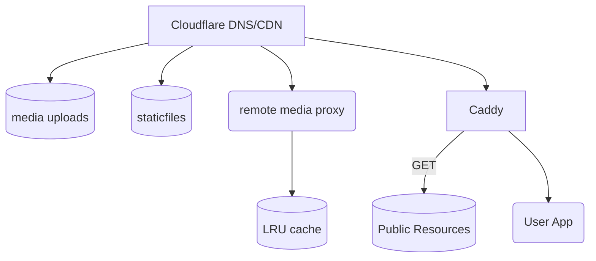
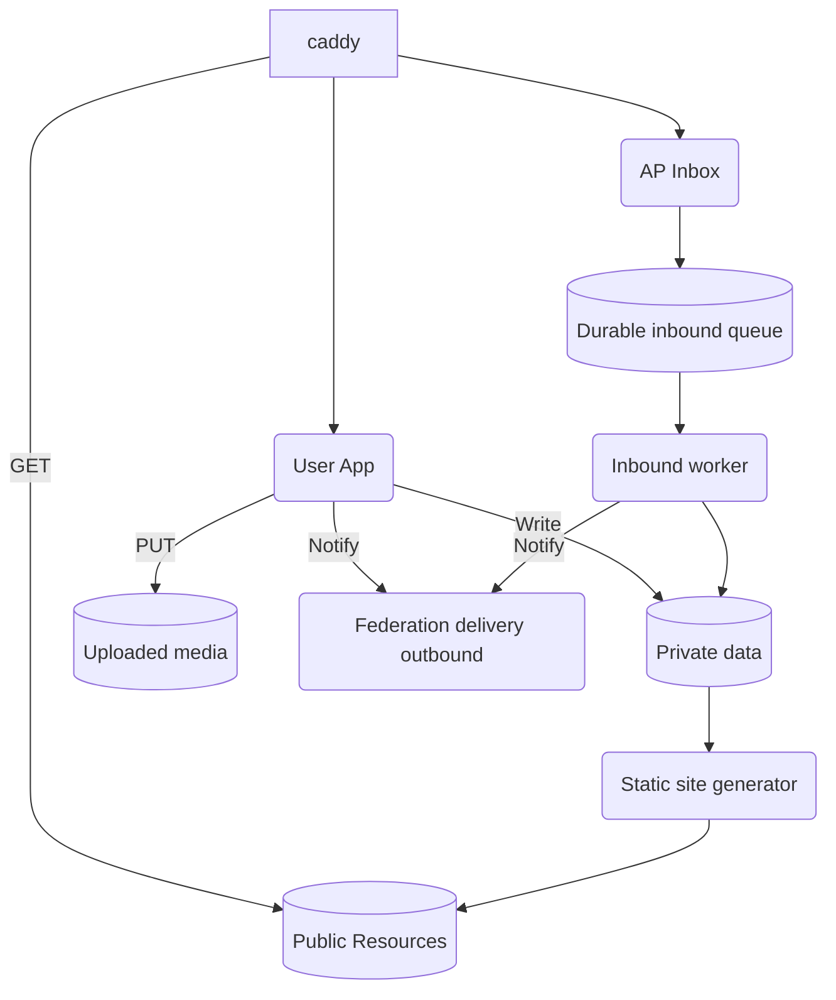

# Architecture Overview

- Resources are primary. 
- Databases index and coordinate them. 
- Applications manipulate them. 
- Protocols distribute them.

## Workloads

| Priority | Component | Recommended approach |
| --- | --- | --- |
| **1** | Outbound federation | Durable delivery queue, asynchronous workers, retries |
| **2** | Inbound federation | Durable ingestion, deduplication, asynchronous processing |
| **3** | Remote object retrieval | Background fetching, caching, security controls |
| **4** | Public object serving | Static JSON or HTTP caching |
| **5** | Social graph | Indexed relational tables |
| **6** | Media | Static serving, separate storage |
| **7** | Timeline retrieval | Fan-out on read initially |
| **8** | Real-time updates | SSE when needed |

## Architecture

### Web Front End


### App Server(s)



### Inbox receive and process
```
Remote ActivityPub Server
          |
          v
    POST /inbox
          |
          v
  Basic HTTP validation
          |
          v
  Durable inbound queue
          |
          +----> HTTP 202 Accepted
          |
          v
    Background Worker
          |
          +--> Verify signature / authorization
          |
          +--> Parse and validate Activity
          |
          +--> Deduplicate
          |
          +--> Update local objects
          |
          +--> Update recipient timelines
          |
          +--> Generate notifications
```

---
### Outbox process
```
Local User Publishes Activity
             |
             v
      Save Activity
             |
             v
     Determine Recipients
             |
             v
      Delivery Planner
             |
             v
    Durable Delivery Queue
             |
       +-----+-----+
       |     |     |
       v     v     v
     Worker Worker Worker
       |     |     |
       v     v     v
    Remote ActivityPub Servers
```

```
                  PUBLISHING APPLICATION
                           |
                           | Submit delivery job
                           v
                  DELIVERY SERVICE
                           |
                   Durable spool
                           |
                    Job scheduler
                           |
                 Transport adapters
                           |
              +------------+------------+
              |            |            |
              v            v            v
          ActivityPub     Email       Webhooks
              |            |            |
              v            v            v
          HTTP POST       SMTP        HTTP POST
```
